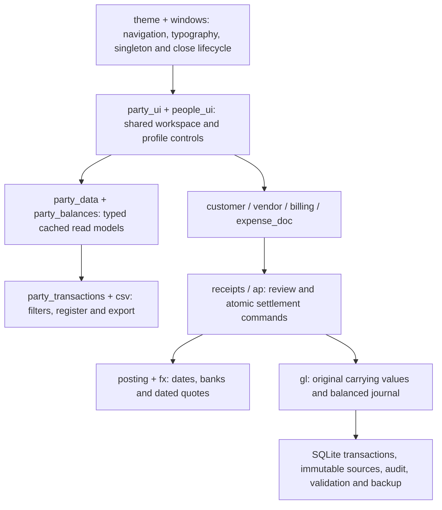

# Architecture and control review — 0.19.0

Reviewed on 2026-10-30. Scope: the local desktop application, shared Customer/Vendor workflows, settlement commands, window lifecycle, reporting and additive upgrade compatibility. This is an engineering review, not a tax certification or an external security audit.

## Findings and changes

| Finding | Result |
| --- | --- |
| Vendor changed the application's navigation while Customer used a different page shell | One session-wide navigation preference; the same toolbar, master list, overview, detail tabs and transaction register implementation serves both centers. Switching modules no longer changes navigation density. |
| Page-specific text sizes, spacing and form layouts had diverged | Root and native windows use the same typography definition. Shared profile editors have vertical categories, responsive contact/address fields, bounded scrolling and visible save controls. |
| Balances and metadata were queried repeatedly while drawing lists | Typed batch read models and transaction-event caches replace the duplicate list queries. Local writes, external commits, schema changes and restore invalidate the cache. Query failures show an error instead of an empty list or a verified zero. |
| Customer receipts lacked the supplier-payment review/idempotency contract | Receipt review freezes the amount, remaining balance, original invoice source, deposit account and dated quote. An immediate transaction rechecks them and commits the payment, number, journal, source and audit together. An identical request returns the original payment; a changed request payload fails. |
| Receipt backdating could distort earlier A/R after a later void | Shared settlement controls reject future dates, locked periods, dates before the source and dates before later receipts/reversals. A regression still diagnoses pre-existing negative historical A/R without rewriting it. |
| Deposit-account checks were weaker than supplier bank checks | Shared account checks reject inactive/non-Asset/control accounts and mixed-currency bank postings. Supplier payments require explicit matching bank currency. Receipts use the configured GL deposit role: without an explicit bank currency it accepts only GL base currency; foreign receipts require an explicit matching bank currency. |
| Profile/account/journal dirty detection and native close handling differed | Clean forms close directly. Changed supported forms offer return, save and discard. Receipt/payment close actions open a review before recording. Journal close can save a manual draft, never post it. Failed validation retains input. Existing Task/invoice preview workflows retain return/discard protection. |
| Report exports had separate CSV encoders | One encoder escapes quotes and neutralizes spreadsheet formula prefixes in untrusted text, including whitespace-prefixed formulas. Typed monetary cells retain valid negative numeric amounts. Customer/Vendor screen and export use the same event/filter contract. |
| Old page branches, duplicated FX lookup and balance functions remained | Removed unreachable Customer/Vendor page wrappers, duplicated center orchestration, duplicate balance SQL and the old export codec. A/P and receipt posting use shared FX provenance and settlement validation, retaining separate A/R and A/P allocation rules. |
| GL help text still said supplier payment was unavailable | Updated it to direct users to Pay Bills and explain manual control-account reconciliation. |

## Responsibilities

Rendering does not authorize a financial write. UI availability checks help the user; command-side checks inside the write transaction remain authoritative. Cross-module shortcuts focus an existing editor instead of replacing its draft. Window placement remains a creation hint: live dragging/DPI observations are never echoed into continuous position/size commands.

Display totals retain their meaning. Customer amounts are outstanding A/R; the Vendor list's **Recorded** amounts are gross recorded bills, not unpaid A/P. Vendor overview/open-document actions use reconciled supplier A/P. Missing source evidence is **Needs review** or **Unavailable**, never an assumed zero. Currencies remain separate.

## Actual desktop examples

- [Customer Center](screenshots/customer-center-0190.png) and [Vendor Center](screenshots/vendor-center-0190.png): the same navigation and workspace structure.
- [Customer settings](screenshots/customer-editor-0190.png) and [Vendor settings](screenshots/vendor-editor-0190.png): shared form controls and save behavior.
- [Receipt confirmation](screenshots/receive-payment-review-0190.png) and [supplier payment confirmation](screenshots/pay-bills-review-0190.png): shared readable review, explicit confirmation and safe initial focus.

## Data and migration

Schema 19 adds `receipt_requests` with unique request/payment links, immutable payloads and audit coverage. Existing receipt dates, voids, invoice snapshots, supplier allocations, original GL sources and numbering history are retained. No historical receipt requests or guessed payments are manufactured. The existing `ap_banks` table also supplies receipt currency checks; a second bank registry was deliberately avoided.

Restore clears party caches and draft/background state. Migration verification uses an online backup in a protected disposable directory, changes only the copy's company identity, compares all pre-existing table columns and checks the live source hash. Never launch a test GUI against the production company database.

## Evidence and remaining boundaries

- Release gates: `build.ps1` runs formatting, Clippy with warnings denied, regular tests and the release build. The optional real-PDF and Bank of Canada historical-lookup tests are run separately. Results are recorded in `AUDIT.md`.
- Actual widget renders: `src/gui/design_preview.rs` captures both centers, compact/full navigation, 900×650 layouts, profile editors, Bill, Receive Payment, Pay Bills and empty registers. Mesh rasters under `target/native-0190-preview` are generated from the desktop widgets, not the old browser prototype. They supplement interaction tests; they are not a physical multi-monitor/manual GPU acceptance test.
- Financial regressions cover repeated and changed requests, stale balances/quotes/accounts, source mismatches, locked/future/backdated settlements, atomic rollback including numbering/audit, reversal/cutoff behavior, original foreign carrying values and A/P concurrent allocations.
- Dependency duplicates were inspected with `cargo tree --duplicates`: version differences originate in third-party dependency constraints, with some build/runtime duplicates. No dependency update was forced just to remove them. `cargo-audit` is not installed, so no RustSec vulnerability-scan result is claimed.
- Remaining larger modules include `main.rs`, migrations, tax administration and the GL editor. They still contain legacy presentation/query helpers and some bilingual messages. This release extracts shared high-risk workflows; it does not claim a complete rewrite or universal English translation.
- This remains a single local Windows-account application. Existing file ACLs, company locks, prepared queries, source immutability and backup checks provide useful controls. They do not create role separation, encrypted database storage, tamper-proof evidence or protection from an administrator editing SQLite directly.
- Receive Payment currently applies to one invoice and uses the GL deposit role. Pay Bills handles several bills for one supplier/currency with an explicit bank. Credits, advances, discounts, cross-currency bank conversion and a general customer payment allocation workbench remain separate capabilities.

## Accounting-record requirements

The control design supports traceability from source documents through settlements to summarized accounts, as described by the [CRA audit-trail guidance](https://www.canada.ca/en/revenue-agency/services/tax/businesses/topics/keeping-records/review-business-systems-keeping-audit-trails-business-transactions.html). Database source links cannot establish whether an underlying commercial transaction actually happened.

Readable electronic records and supporting material must be retained under applicable record-keeping requirements; the CRA guidance describes a general six-year electronic-record retention period. Daily backup rotation is not that archive. See [CRA Electronic Records, September 2026](https://www.canada.ca/en/revenue-agency/services/forms-publications/publications/15-2/electronic-records.html).

Tax-code defaults and recovery calculations do not establish ITC eligibility or documentary sufficiency. Supplier registration, business use, place of supply, restrictions and original supporting evidence still need review. See [CRA input tax credits](https://www.canada.ca/en/revenue-agency/services/tax/businesses/topics/gst-hst-businesses/calculate-prepare-report/input-tax-credit.html). This release does not change tax rates or mark historical records compliant automatically.
