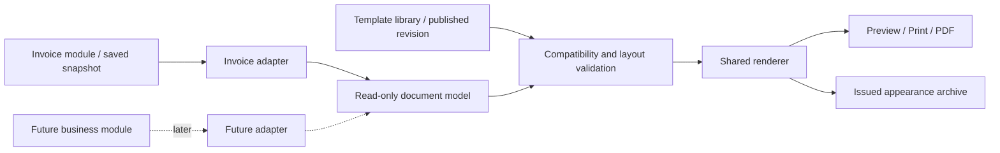

# Document Template System Plan

Date: 2026-10-31. Scope: an easy-to-use Invoice template system with a stable extension contract. Deposit, PO and their accounting/workflow models are not implemented by this plan or the current UI refinement release. `temp` is interpreted as Template.

## Product goal

A user should be able to choose a layout, change branding and supported sections, preview a realistic document, and publish a reusable version without editing HTML or learning a report designer. Adding a future document type should require a small, explicit adapter and its own field schema, rather than duplicating the template editor or modifying invoice accounting rules.

The system has three separate responsibilities:

1. The business module validates and snapshots the transaction.
2. A document adapter supplies a typed, read-only presentation model.
3. A versioned template controls permitted layout and appearance; a renderer produces preview/print/PDF from the same model.

Templates cannot create transactions, alter amounts, choose tax treatment or generate document numbers. Deposit and PO reuse presentation infrastructure when their business modules exist; they do not inherit Invoice posting behavior.

## Current foundation and gaps

`src/invoice_template.rs` currently stores one company template: accent, payment terms, payment instructions and footer. `templates/invoice.html` is the bundled layout. `src/invoice.rs` renders validated invoice data through that layout; PDF/print use the existing HTML output pipeline.

Payment terms and instructions are already copied into issued invoice data and retained on reprint. Current appearance is loaded from the company's latest template, so an old invoice's color/footer can change when reprinted. There is no named template library, immutable layout revision, per-document template selection, or full issued-appearance archive. These are the foundation gaps to address before adding a complex editor.

## User experience

### Template library

Entry: Setup → Document Templates. Initially the only enabled document type is Invoice. Do not show nonfunctional Deposit/PO tabs.

- List named templates with a thumbnail, paper format, published revision, default marker and last change.
- Start from a small bundled set such as Standard, Compact and Service. These are presentation variants using the same Invoice data contract.
- Common actions: New from preset, Edit draft, Duplicate template, Preview, Publish, Set default and Archive.
- Duplicating a template never duplicates an invoice. Archiving a template removes it from future selection and retains versions used by historical documents.
- Show Draft changes independently from Published revision. Save Draft is a reversible settings operation; Publish creates an immutable revision.

### Editor

Use a restrained three-area layout:

| Area | Purpose |
| --- | --- |
| Left: sections | Header, company, customer/billing details, document details, lines, totals, payment information, notes/footer. Users select a section and can move optional sections with explicit Up/Down controls. |
| Center: preview | Fit page / Actual size, page navigation and clear Sample data / Saved invoice context. The sample number is labelled as sample; preview never reserves a real number. |
| Right: properties | Only settings relevant to the selected section. Show a small set of common choices first, with advanced settings collapsed. |

On a narrower window, convert properties into a selectable panel instead of shrinking the page and controls until unreadable. Keep Save Draft, Preview and Publish reachable. Retain the existing singleton and unsaved-input guard.

Common settings: logo, accent, supported font, Letter/A4, margins, address positioning, optional columns, column order/width within safe bounds, notes and footer. Mandatory document identity, currency and financial information cannot be hidden. Terms/default payment instructions are clearly distinguished from decorative footer text and preserve existing snapshot rules.

Avoid arbitrary pixel positioning as the default editor. Structured sections, controlled column choices and presets handle common business needs with fewer broken pages. Keyboard section movement is available alongside any later drag interaction.

### Invoice selection and issue

The Invoice editor can select one published compatible template, defaulting to the company's Invoice default. Changing the default affects new drafts; an open invoice draft does not silently change when someone publishes another template.

Preview shows the chosen template name/revision and the financial review already required by the Invoice module. Changing a commercial field invalidates the financial review. Changing a template selects a different appearance and must be reflected in the final document preview before issue.

After issue, record the selected revision with the invoice. Reopening and reprinting should clearly distinguish an original issued document from a current balance copy.

## Reusable architecture

Proposed boundaries:

| Component | Responsibility |
| --- | --- |
| `DocumentDescriptor` | Stable type ID, schema version, display name, required/optional sections, supported columns and field metadata. Register Invoice only initially. |
| `DocumentAdapter` | Produce the presentation model from an already authorized snapshot. Invoice-specific amount/date/tax validation stays in Invoice/domain code. |
| `DocumentModel` | Common company/party identity, number/date/currency, sections and typed display values; kind-specific data is carried in a validated namespaced payload. |
| `TemplateDefinition` | Paper, tokens, section order, allowed column layout and asset references. No executable expressions, SQL or arbitrary callbacks. |
| `TemplateRevision` | Immutable published definition plus compatible document/renderer schema versions and content hash. |
| `DocumentRenderer` | Format typed values, escape text, paginate and generate the common output used for preview, print and PDF. |
| `TemplateLibrary` / `TemplateEditor` | Shared GUI using descriptors to populate valid controls and field choices. |

Field identifiers are stable names such as `company.name`, `party.billing_address`, `document.number` and `invoice.due_date`. Store identifiers independently of their editable display labels. A future `po.delivery_date` belongs to the PO descriptor and is unavailable to Invoice templates. Missing required fields fail validation with a specific message; optional missing fields use an explicit omission rule, never a fabricated zero.

Use scaled integers/decimal-safe domain values and explicit currencies; do not recompute source totals with floating point in a layout expression. The renderer validates that displayed mandatory totals and currency agree with the model before export.

## Versioned storage proposal

These tables belong to a future migration, not the current UI-only release:

| Store | Core fields |
| --- | --- |
| `document_templates` | ID, stable document-kind ID, name, archived flag, draft definition, draft concurrency version, current published revision |
| `document_template_revisions` | Template ID, revision number, definition JSON, layout schema version, supported model/renderer versions, content hash, creation metadata |
| `document_template_defaults` | Document-kind ID → published revision; default changes are audited |
| `document_template_assets` | Immutable asset hash, validated media type, dimensions, bounded bytes |
| `document_appearances` | Document-kind ID + record ID, pinned revision/model/renderer versions, immutable render input, asset manifest, original output archive reference/hash |

Published revisions/assets used by issued documents are retained. Draft saving uses optimistic version checks so a stale editor cannot overwrite a newer draft. Publishing validates the layout and assets in one transaction and records an audit event. Issuing pins the chosen published revision as part of the authoritative document issue transaction; the renderer has no independent financial-write path.

Separate transaction issue from PDF file generation. If PDF generation fails after a successful issue, the document remains issued and the UI offers Retry Export. A retry uses the same document ID and pinned appearance; it never issues another invoice. Archive-file creation must be atomic and bounded; failed file generation cannot create a second numbered transaction.

## Historical appearance and reprints

- Preserve the existing financial/commercial snapshot. A later template edit cannot change the issued layout revision, logo assets, terms or original totals.
- Archive original issued output for exact reprint. Revision pinning alone cannot guarantee byte-identical PDFs across browser/font/OS changes; retain the original PDF if exact reproduction is required.
- Define render purpose explicitly: Original issued document, Invoice copy with balance as of [date], or Draft preview. A live payment balance is displayed only in a copy that clearly states its cutoff; do not silently mix updated balances with a claim of an identical original artifact.
- If reformatting an old document is allowed, label it as a reformatted copy and audit the action. It must not alter the source invoice or its pinned original appearance.
- Legacy invoices without a saved template revision remain in a compatibility renderer. Label original appearance as not recorded; do not manufacture an original revision from today's settings. Provide an explicit current-format copy where appropriate.

## Safety and predictability

- The default editor accepts structured settings and plain text, not arbitrary HTML, scripts, filesystem paths or remote URLs.
- Field binding uses a whitelist and HTML escaping. A customer name containing markup or template syntax remains literal text. Layout rendering cannot query the company database or make network requests.
- Import logos as bounded, validated raster assets with explicit size/pixel limits and immutable hashes. SVG/HTML/font imports need a separately specified sanitization and licensing policy; do not enable them by default.
- Preview uses disposable sample/copied data and a read-only model. It cannot change invoice numbering, payments, tax, GL, template defaults or published revisions.
- Rate values and tax snapshots come from the business document; missing source data is a visible validation issue. Templates do not retrieve FX or infer tax rules.
- Debounce preview edits, cancel obsolete jobs and tag results by draft revision so an older preview cannot replace a newer one. Keep the form responsive and preserve pending input on rendering errors.
- Long descriptions, Unicode, large/signed amounts where allowed, many lines and multi-page output need explicit wrapping and pagination policies. Repeat column headings and prevent totals/signature blocks being cut across pages where practical.

## Delivery phases

| Phase | Deliverable | Acceptance |
| --- | --- | --- |
| 1. Contracts and compatibility | Invoice descriptor/adapter, versioned layout schema, renderer boundary, tests around the existing layout. | Current invoices and exports retain correct source values; preview is read-only. No Deposit/PO implementation. |
| 2. Library and simple editor | Presets, named drafts, logo/colors/paper/columns/sections, shared preview and publish. | A user can start from a preset, preview a realistic invoice and publish without HTML; errors identify the exact setting. |
| 3. Issue pinning and archive | Per-invoice published template selection, immutable appearance reference, original/copy modes and export retry. | Template/default changes do not change old invoices; failed PDF output cannot duplicate issue/numbering; exact reprint uses archived output. |
| 4. Migration and desktop acceptance | Legacy compatibility, backup/restore of templates/assets/archives, narrow layouts, keyboard, DPI and multi-monitor checks. | Historical data preserved; original-appearance limitations explained; all controls reachable and dirty drafts protected. |
| Later, when requested | Register a new descriptor, adapter, sample model and acceptance suite for Deposit or PO. | Reuse library/editor/renderer/archive; define that document's required fields, lifecycle and accounting in its own module first. |

Do not build speculative Deposit/PO tables, posting rules or disabled UI now. Extensibility is delivered through versioned contracts and adapters, with a small working Invoice implementation first.

## Test and release checklist

1. Snapshot compatibility, schema migration rollback, backup/restore and revision/asset retention.
2. Save Draft / Publish / Set default / Archive semantics; stale edit rejection and immutable publication.
3. Preview has zero business writes; unknown or type-incompatible fields are rejected; text/script/placeholder inputs are escaped.
4. Pinned old invoice remains stable after publishing another template or replacing a logo. Live balance copy is clearly dated.
5. Single/multi-page Letter/A4 output with long text, Unicode, mixed widths and representative tax/rounding snapshots. Preview/print/PDF use the same render input.
6. Export failure and retry preserve the existing issued invoice and number. Archive output is verified against its stored hash.
7. New future-type adapter can render a test document through the shared editor/renderer without changes to Invoice totals or posting code. A test fixture is sufficient until a new business module is requested.
